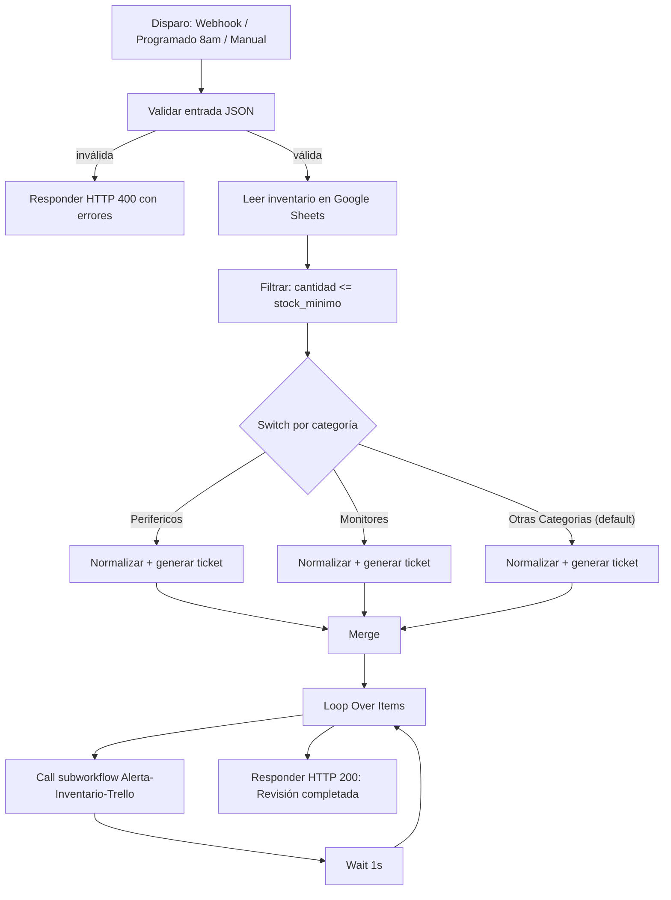

# Bitácora Unificada del Proyecto — Automatización de Inventario (n8n)

**Proyecto:** Sistema de automatización para revisión de inventario y generación de alertas de reposición
**Curso:** Automatización Inteligente de Procesos — EAM 2026-II
**Equipo:** William Rodríguez, Kevin Rengifo, Bryan Benavides, Michael Menotti *(roles específicos: [COMPLETAR])*
**Corte:** Corte 2 — Entrega 26 de octubre de 2026
**Fecha de esta bitácora:** 27 de octubre de 2026
**Estado general:** 🟡 Funcional en entorno local, con limitaciones conocidas pendientes de corregir
**Fuentes usadas para esta bitácora:** `Automatizacion-Inventario (1).json`, `Alerta-Inventario-Trello (1).json`, `Manejador_Errores.json`, `README.md`, `Presentacion_Corte_2.pdf`

> Convenciones de estado usadas en este documento: ✅ Terminado y verificado · 🟡 Funciona con limitaciones conocidas · 🧪 Probado puntualmente · 💡 Mejora propuesta, no implementada.
> Donde la información no estaba disponible en los archivos revisados se usa la marca `[COMPLETAR]`; donde un dato existe pero no pudo verificarse con total certeza se usa `[VERIFICAR]`.

---

## 1. Identificación y alcance del proyecto

### 1.1 Proyecto
Automatización construida en **n8n** para reemplazar la revisión manual de inventario. Hoy, una persona compara a mano, en una hoja de cálculo, la cantidad disponible de cada producto contra su stock mínimo, sin horario fijo ni registro de qué ya fue reportado. Esto provoca que las reposiciones lleguen tarde, se olviden, o se dupliquen sin control.

### 1.2 Equipo y roles
| Integrante | Rol |
|---|---|
| William Rodríguez | [COMPLETAR] |
| Kevin Rengifo | [COMPLETAR] |
| Bryan Benavides | [COMPLETAR] |
| Michael Menotti | [COMPLETAR] |

### 1.3 Objetivo
Revisar automáticamente el inventario completo, detectar los productos con cantidad por debajo del stock mínimo, clasificarlos por categoría y crear una tarjeta de reposición en Trello por cada alerta, sin intervención humana, dejando registro de los errores que ocurran en el proceso.

### 1.4 Qué incluye el sistema (dentro de alcance)
- Disparo del proceso por **webhook autenticado**, por **programación diaria** (8:00 a.m.) o **manualmente** para pruebas.
- Validación de la entrada antes de tocar cualquier sistema externo.
- Lectura del inventario desde Google Sheets.
- Filtrado de productos con `cantidad <= stock_minimo`.
- Clasificación de las alertas en tres rutas por categoría.
- Creación de tarjetas de reposición en Trello vía subworkflow.
- Registro de errores de ejecución en Google Sheets.

### 1.5 Qué queda fuera de alcance
- Generación automática de pedidos a proveedores.
- Facturación o contabilidad.
- Control de duplicados entre ejecuciones (ver sección 5).
- Recepción de eventos desde internet real (el webhook solo responde en `localhost`).

### 1.6 Archivos que componen el proyecto
| Archivo | Tipo | Función |
|---|---|---|
| `Automatizacion-Inventario (1).json` | Workflow principal | Orquesta todo el proceso: disparo, validación, lectura, filtro, clasificación y llamado al subworkflow de Trello |
| `Alerta-Inventario-Trello (1).json` | Subworkflow | Recibe los datos de una alerta y crea la tarjeta en Trello vía API |
| `Manejador_Errores.json` | Workflow de errores | Se activa automáticamente si cualquiera de los otros dos falla; registra el fallo en Sheets |
| `README.md` | Documentación | Explica instalación, configuración, limitaciones y pruebas de ejemplo |
| `Presentacion_Corte_2.pdf` | Presentación | Exposición formal del proyecto para la entrega del corte 2, con evidencia de ejecución real |

### 1.7 Repositorio del proyecto
Enlace de GitHub: **[https://github.com/Kevin-Rengifo0124/inventario-automatizacion.git]** 

---

## 2. Proceso manual vs. proceso automatizado

### 2.1 Proceso manual (antes)
1. Una persona abre la hoja de cálculo del inventario.
2. Revisa producto por producto la cantidad disponible contra el stock mínimo.
3. Si detecta un producto bajo mínimo, avisa manualmente (chat, tablero, memoria) para que se reponga.
4. No hay horario fijo de revisión ni registro de qué ya se reportó.

**Ejemplo documentado en la presentación:** el "Mouse inalámbrico" baja a 3 unidades (mínimo 5) y nadie lo nota a tiempo porque la revisión depende de que alguien recuerde hacerla.

**Consecuencias:** reposiciones tardías u olvidadas, falta de trazabilidad, dependencia total de la disciplina de una persona.

### 2.2 Proceso automatizado (ahora)



### 2.3 Regla de negocio formalizada
```
SI cantidad <= stock_minimo → clasificar por categoría y crear tarjeta de reposición
SI NO → no hacer nada (no es un error, es un resultado normal)
```

---

## 3. Funcionamiento detallado

### 3.1 Disparo del workflow principal
El workflow `Automatizacion-Inventario` tiene tres formas de iniciar:
- **Webhook** `POST /revisar-inventario`, protegido con autenticación por header (`headerAuth`).
- **Schedule Trigger**, programado para ejecutarse diariamente a las **8:00 a.m.**
- **Trigger manual**, usado para pruebas dentro del editor de n8n.

### 3.2 Validación de entrada
Un nodo de código (JavaScript) valida que el cuerpo de la petición traiga:
- `accion` con el valor exacto `"revisar_stock"`.
- `solicitud_id` presente (usado como identificador de trazabilidad de la ejecución).

Si falta alguno de los dos, el nodo construye una lista de errores y el flujo responde inmediatamente **HTTP 400** sin leer ni escribir en ningún sistema externo (ni Sheets ni Trello). Esto es intencional: nada se modifica hasta que la entrada es válida.

### 3.3 Lectura y filtrado del inventario
- Un nodo de Google Sheets lee todas las filas de la hoja de inventario (documento y hoja configurados con credenciales OAuth2 propias; identificadores de la instalación original, deben reconectarse al importar).
- Un nodo de filtro conserva únicamente las filas donde `cantidad <= stock_minimo`.

### 3.4 Clasificación por categoría (Switch)
El nodo Switch compara el campo `categoria` **de forma exacta y sensible a mayúsculas/tildes**, contra dos valores:
- `"Perifericos"`
- `"Monitores"`

Cualquier otro valor —incluida una variación mal escrita como `"perifericos"` o `"Periféricos"`— cae por defecto en la ruta **"Otras Categorías"**. No hay normalización previa a esta comparación, lo que es una limitación conocida (ver sección 5).

### 3.5 Normalización y generación de ticket
Cada una de las tres ramas pasa por un nodo `Set` que:
- Normaliza el nombre del producto (minúsculas, sin espacios/caracteres especiales) para construir el ticket.
- Genera un identificador único tipo `ticket`, con el patrón `<categoria-normalizada>-<producto-normalizado>-<timestamp>` (por ejemplo: `perifericos-mouse-inalambrico-<timestamp>`).
- Construye el `asunto` / mensaje de alerta que se enviará a Trello.

### 3.6 Unión y envío a Trello
- Las tres ramas se reúnen de nuevo en un nodo **Merge**.
- Un nodo **Loop Over Items** recorre cada alerta una por una.
- Por cada alerta se llama al subworkflow `Alerta-Inventario-Trello` (nodo *Execute Workflow*), y el flujo principal **espera la respuesta** antes de continuar — así no confirma éxito sin saber si la tarjeta se creó realmente.
- Entre cada llamada hay un nodo **Wait** de **1 segundo**, para no exceder los límites de la API de Trello.

### 3.7 Respuesta final
Si todo el proceso se completa, el webhook responde **HTTP 200** con:
```json
{ "ok": true, "mensaje": "Revisión de inventario completada" }
```

### 3.8 Caso de ejemplo documentado (presentación, corte 2)
Con `solicitud_id: "PRUEBA-003"`:
- Se leen 8 filas de inventario.
- 6 pasan el filtro de stock mínimo.
- Se distribuyen en: 2 Periféricos, 1 Monitor, 3 Otras Categorías.
- Se generan 6 tickets y 6 tarjetas nuevas en Trello.

---

## 4. Integraciones y configuración

### 4.1 Google Sheets
- Usado para leer el inventario y para registrar errores (hoja separada, ver sección 5).
- Credenciales: OAuth2, cuenta de Google propia con Sheets/Drive API habilitadas.
- Documento y hoja identificados por ID de la instalación original — deben reconectarse manualmente al importar el proyecto en otra cuenta.

### 4.2 Trello
- El subworkflow `Alerta-Inventario-Trello` llama a la API de Trello **por HTTP Request directo** (`POST https://api.trello.com/1/cards`), no con el nodo nativo de Trello, para controlar explícitamente los parámetros enviados: `idList`, `pos`, `name`, `desc`.
- Autenticación: **Header Auth** con key/token de Trello (no incluidos en los archivos; deben configurarse como credencial propia).
- El `idList` (lista del tablero donde caen las tarjetas) también es específico de la instalación original y debe reconfigurarse.
- Nombre de la tarjeta generado como: `"Reposición urgente: [producto]"`.

### 4.3 Webhook
- Ruta: `POST /revisar-inventario`.
- Autenticación: Header Auth.
- **Limitación activa:** solo responde en `localhost`; no hay túnel configurado para recibir peticiones desde internet.

### 4.4 Workflow de errores
- Configurado como *Error Workflow* tanto en `Automatizacion-Inventario` como en `Alerta-Inventario-Trello`: si cualquiera de los dos falla, n8n dispara automáticamente `Manejador_Errores`.

### 4.5 Requisitos para desplegar
- n8n 2.36.9 o superior.
- Cuenta de Google con Sheets/Drive API habilitadas.
- Cuenta de Trello con tablero y lista ya creados.
- Importar en orden: `Manejador_Errores` → `Alerta-Inventario-Trello` → `Automatizacion-Inventario`, y reconectar a mano credenciales, hojas, `idList` y el enlace al subworkflow.
- Recomendación del README: ejecutar `ipconfig /flushdns` antes de correr el flujo, por resolución DNS local intermitente observada en el entorno de pruebas.

---

## 5. Errores, limitaciones y recuperación

### 5.1 Manejador de errores
- Workflow `Manejador_Errores`, de solo 2 nodos: `Error Trigger` + nodo de Google Sheets que agrega una fila a la hoja **"Errores"**.
- Columnas registradas: fecha/hora, workflow donde ocurrió, nodo que falló, mensaje de error y número de ejecución.
- Se dispara automáticamente, sin intervención humana, cuando falla `Automatizacion-Inventario` o `Alerta-Inventario-Trello`.

### 5.2 Distinción importante entre "sin alertas" y "error"
- Que **ningún producto** esté bajo el mínimo en una ejecución **no es un error**: es un resultado normal del negocio, el flujo simplemente termina sin crear tarjetas.
- Un fallo real al llamar a Trello (por ejemplo, endpoint inválido o caído) **sí es un error** y por eso queda registrado.

### 5.3 Limitación conocida: sin control de duplicados 🟡
- El flujo **no verifica** si ya existe una tarjeta de reposición para un producto antes de crear una nueva.
- Cada ejecución programada (diaria, 8 a.m.) vuelve a generar tarjetas para los productos que siguen bajo mínimo, aunque ya se hayan reportado antes.
- **Evidencia real observada** (presentación, corte 2): el contador de la lista de Trello mostró **66 tarjetas acumuladas**, confirmando en la práctica que esta limitación ya se manifestó en el entorno de pruebas.
- Mejora propuesta (💡, no implementada): consultar las tarjetas existentes en Trello antes de crear una nueva, para evitar duplicados.

### 5.4 Otras limitaciones conocidas
- 🟡 El Switch de categorías es sensible a mayúsculas/tildes y no normaliza antes de comparar; cualquier variación de escritura cae en "Otras Categorías" por defecto.
- 🟡 El webhook solo es accesible en `localhost`, no hay recepción real desde internet.
- 🟡 Resolución DNS local intermitente en el entorno de pruebas (mitigada con `ipconfig /flushdns`, no resuelta de raíz).
- 💡 No hay lógica de reintentos automáticos si falla una llamada a Trello o Sheets.

---

## 6. Pruebas realizadas y evidencias

| # | Prueba | Entrada | Resultado esperado | Resultado observado | Estado |
|---|---|---|---|---|---|
| 1 | Caso normal | `solicitud_id` y `accion: "revisar_stock"` válidos, 8 filas de inventario | HTTP 200, tarjetas creadas para productos bajo mínimo | HTTP 200, **6 tarjetas nuevas** creadas en Trello | ✅ |
| 2 | Entrada inválida | `accion: "otra_cosa"`, sin `solicitud_id` | HTTP 400, nada se escribe en Sheets ni Trello | HTTP 400 recibido, sin escrituras | ✅ |
| 3 | Fallo controlado | Se apuntó intencionalmente la llamada a Trello a un endpoint inexistente | La ejecución falla y `Manejador_Errores` registra la fila en Sheets | Ejecución falló y quedó registrada correctamente; el mensaje de error fue de "fallo de conexión" por el mismo problema de DNS mencionado en el README, pero el objetivo de la prueba (verificar el registro de errores) se cumplió | ✅ 🧪 |

**Nota de honestidad del equipo (presentación, corte 2):** no se midió el ahorro de tiempo real ni se comparó formalmente contra el proceso manual; no hay cifras de beneficio cuantificado todavía.

---

## 7. Evolución del proyecto y estado final

### 7.1 Estado actual (corte 2)
- 🟡 Funcional de extremo a extremo en entorno local: disparo, validación, lectura, filtro, clasificación, creación de tarjetas y registro de errores funcionan según lo probado.
- ✅ Separación modular lograda: el subworkflow de Trello está aislado del flujo principal a propósito, para poder cambiar el canal de notificación (por ejemplo, a correo) sin modificar la lógica de revisión de inventario.
- 🟡 Persisten las limitaciones ya descritas (duplicados, categorías sensibles a texto, webhook solo local).

### 7.2 Mejoras pendientes (💡 priorizadas según README y presentación)
1. Control de duplicados antes de crear tarjetas en Trello — **prioridad alta**, ya evidenciada como problema real (66 tarjetas acumuladas).
2. Normalización de categorías antes del Switch (mayúsculas/tildes).
3. Lógica de reintentos ante fallos de red/API.
4. Exposición real del webhook a internet (túnel o despliegue en servidor accesible).
5. Medición formal de ahorro de tiempo frente al proceso manual.
6. Completar enlace del repositorio en la documentación de presentación.

### 7.3 Conclusión
El proyecto cumple el objetivo central planteado: automatizar la revisión de inventario y la creación de alertas de reposición sin intervención humana, con validación de entrada, trazabilidad por ticket y registro de errores. El equipo documentó honestamente sus propias limitaciones con evidencia real (capturas de Trello, pruebas con resultados observados), en lugar de presentar solo el caso ideal.

---

## Anexo A — Inconsistencias detectadas entre archivos
| Inconsistencia | Detalle |
|---|---|
| Roles del equipo | El README no especifica el rol de cada integrante; queda como `[COMPLETAR]` |
| Enlace del repositorio | Aparece como `[COMPLETAR: enlace del repositorio]` tanto en la presentación como en esta bitácora |
| Mensaje de error de la prueba 3 | Se registró como "fallo de conexión" (por el problema de DNS local) en lugar de un error directo de la API de Trello; no invalida la prueba pero conviene aclararlo si se repite en otro entorno |
| Credenciales e IDs | Ningún archivo trae API keys, tokens, IDs de hoja o `idList` reales — todos deben recrearse al importar el proyecto, tal como advierte el README |

## Anexo B — Pendientes explícitos
- [ ] Completar roles del equipo.
- [ ] Completar enlace del repositorio de GitHub.
- [ ] Implementar control de duplicados en Trello.
- [ ] Normalizar categorías antes del Switch.
- [ ] Medir y documentar el ahorro de tiempo real frente al proceso manual.
- [ ] Verificar si la resolución DNS intermitente se resuelve de forma permanente o solo se mitiga con `ipconfig /flushdns`.

## Anexo C — Estructura de archivos del repositorio
```
/
├── Automatizacion-Inventario (1).json   # Workflow principal
├── Alerta-Inventario-Trello (1).json    # Subworkflow de Trello
├── Manejador_Errores.json               # Workflow de manejo de errores
├── README.md                            # Documentación de instalación y uso
└── Presentacion_Corte_2.pdf             # Presentación de la entrega del corte 2
```

---
*Bitácora generada a partir del análisis directo de los archivos del proyecto (workflows JSON, README y presentación), siguiendo la estructura de la plantilla de referencia `Bitacora_Unificada_Proyecto_largo 1.md`.*
